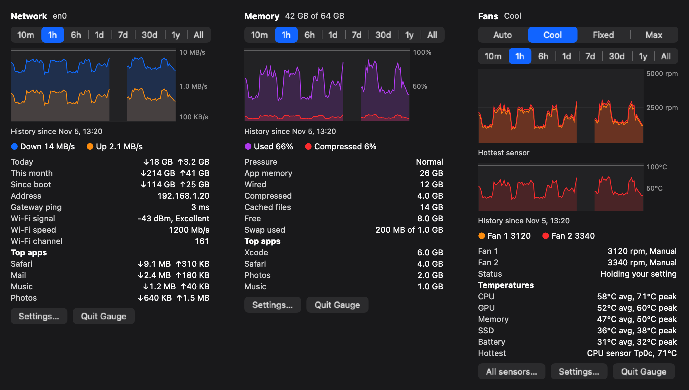
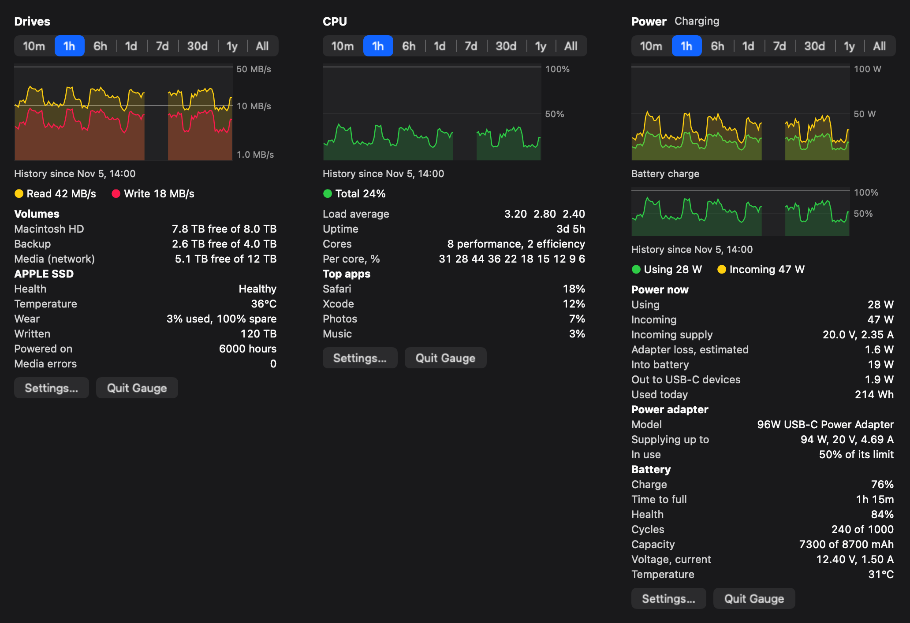
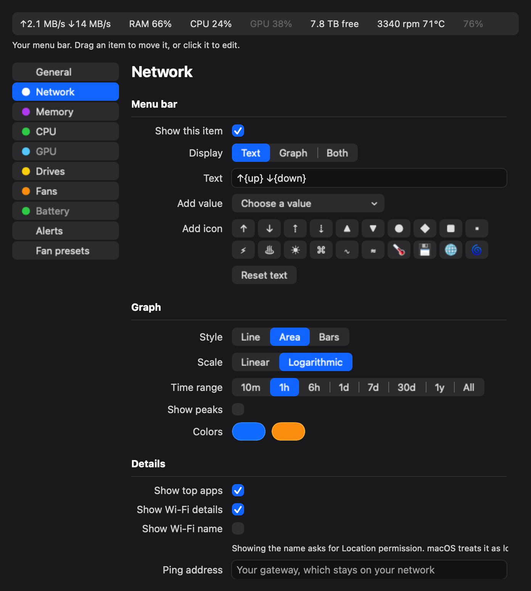
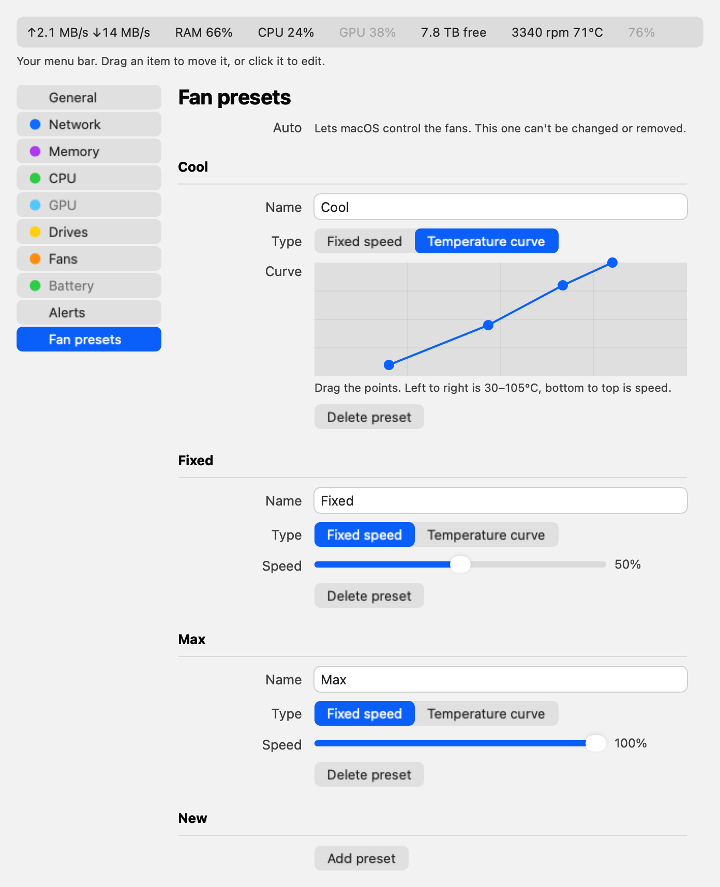

# Gauge

A macOS menu bar system monitor written in Rust. It shows network speed, RAM, CPU, drives and fans in the menu bar. Click an item for a history graph and details.



*Images are drawn by the app using sample data.*

> **Fan control can overheat or damage your Mac if used wrongly.** It uses undocumented Apple interfaces and is provided with no warranty.

## Status

Tested on one machine only: an M1 Max MacBook Pro on macOS 27. Other Macs are untested, and fan control is expected to fail on many of them:

- The helper refuses to run on Macs with the `Ftst` key, which reportedly includes M3 and M4 models.
- Macs that use the lowercase `F0md` key, reportedly the M5, aren't supported.
- Intel Macs aren't supported.

Fan control so far has been tested with speed changes of about 200 rpm near maximum speed, and with the return to Auto after a disconnect, a hang, a killed app and a crashed helper. Large speed changes and the Cool curve at normal temperatures haven't been tested yet.

## Features

- **Network:** live speed, data used today and this month, gateway ping, Wi-Fi signal, and top apps
- **Memory:** pressure, app, wired, compressed, cached, swap, and top apps
- **CPU and GPU:** total and per-core load, load average, GPU use, and top apps
- **Drives:** free space, read and write speed, and NVMe health
- **Fans:** live speed, temperature, and presets you can add, rename and delete, with fixed speeds or temperature curves
- **Sensors:** a window listing every temperature, power, voltage and current reading. Named sensors are from community research and apply to M1 chips; the rest keep their raw codes
- **Battery:** charge, health, cycles and power, plus wireless keyboards, mice and trackpads that report a charge
- **Graphs:** ranges from 10 minutes to All, which grows with the saved history, with line, area or bar styles
- **Menu bar:** edit what each item says, add icons, adjust the spacing, and drag items into any order
- **Alerts:** low disk space, high temperature, memory pressure and lost connection
- **Command line:** `gauge` prints every reading as JSON

## Screenshots

Drives, CPU and GPU panels:



Settings has a live copy of your menu bar. Drag an item to move it, or click it to edit:



Fan settings, with a draggable curve, in light mode:



To regenerate these with sample data:

```bash
target/release/gauge-app --render gallery network,memory,fans docs/images/panels-dark.png dark
```

## Install

Requires a Rust toolchain and the Xcode command line tools.

```bash
scripts/bundle.sh
open ~/Applications/Gauge.app
```

The bundle gets an ad-hoc signature, so it runs on the Mac that built it but isn't notarized for sharing.

## Fan helper

Monitoring needs no special permissions. Changing fan speed needs a small root helper. To install it, choose a preset other than Auto in the Fans panel, then click **Install fan helper…**.

To remove it:

```bash
sudo /Library/PrivilegedHelperTools/com.gauge.fand-uninstall
```

The helper accepts connections only from the user who installed it. It always clamps speeds to each fan's own limits, so a fan can't be stopped. It returns fans to Auto when:

- Gauge quits, crashes or stops responding for 5 seconds
- temperatures stay above 100°C, or every sensor stops reading
- the helper starts or stops, including after a crash

Fans also start on Auto every time Gauge launches.

**Security limits:** the helper accepts only speeds within each fan's limits, and other users on the Mac can't reach it. Anything already running as your user can use it to change fan speeds within those limits. Malware running as your user could also swap the installer in `~/Applications` before you enter your password, which would give it root. Fixing that needs a signed installer from a paid Apple Developer account, which Gauge doesn't have yet. Only install the helper on a Mac you trust, from source you've built yourself.

## Privacy

Nothing is sent anywhere by default. The Wi-Fi network name is off by default, because macOS treats it as location data and asks for Location permission. History and settings stay in `~/Library/Application Support/Gauge`. Hourly history is kept forever, which costs a few MB a year. Gauge pings your local gateway unless you set another address, and it has no analytics or update checks.

## Layout

| Crate | Purpose |
|---|---|
| `smc` | Reads and writes Apple SMC keys |
| `gauge-core` | Collectors, history, settings and fan curves |
| `gauge` | Command-line tool |
| `gauge-app` | Menu bar app, built on AppKit through `objc2` |
| `fan-proto` | Helper protocol and safety rules |
| `gauge-fand` | Root fan helper |
| `fan-spike` | One-off test tool for fan writes |

Run the tests with `cargo test --workspace`. Some tests read real hardware, and the fan helper's watchdog tests need a Mac with fans.

## License

GNU General Public License v3.0 or later. See [LICENSE](LICENSE). Anyone who distributes a modified version must also share its source under the same license.
